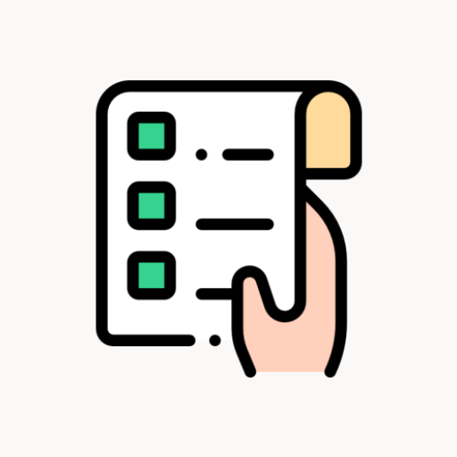

  

# Mis Tareas (MisTareasMVC)

Aplicación móvil desarrollada en Android para la gestión y organización de tareas cotidianas, refactorizada para implementar el patrón arquitectónico **MVC (Modelo-Vista-Controlador)** junto con mejoras en la interfaz de usuario (UI/UX) y una gestión sólida de estados.

## Descripción General

**Mis Tareas (MisTareasMVC)** es una aplicación nativa de Android diseñada para realizar el seguimiento de tareas diarias mediante la sincronización con un servidor remoto y el almacenamiento local en el dispositivo. Esta versión representa una evolución arquitectónica directa respecto a la versión anterior (MiAppNivel4), estableciendo una separación clara de responsabilidades al aislar la lógica de negocio, el manejo de datos y los componentes de la interfaz gráfica en capas bien diferenciadas.

La aplicación se comunica con la API REST pública *DummyJSON* mediante *callbacks* asíncronos, mantiene capacidades sin conexión a través de almacenamiento local en caché y gestiona los cambios de orientación de pantalla de forma fluida mientras ofrece una vista de detalle mejorada.

## Funcionalidades y Mejoras Principales

* **Patrón Arquitectónico MVC:** Refactorización completa en capas independientes: Modelo (`Todo`, `TodosResponse`, `ApiService`), Vista (`MainActivity`, `TaskDetailActivity`, `TaskAdapter`) y Controlador (`TaskController`, `TaskCallback`).
* **Integración con API REST y Controladores Asíncronos:** Obtención y procesamiento de datos remotos mediante **Retrofit 2** y **Gson**, gestionados de forma asíncrona por el controlador a través de un mecanismo personalizado de *callbacks* (`TaskCallback`).
* **Persistencia Local y Funcionamiento Offline:** Almacenamiento local de tareas utilizando `SharedPreferences` y `Gson`, lo que permite la visualización sin conexión a internet y una carga de datos instantánea.
* **Preservación del Estado:** Gestión fiable de cambios de orientación mediante `savedInstanceState` para mantener intacto el estado de la lista de tareas al girar el dispositivo.
* **Interfaz de Usuario y Navegación Optimizadas:**
    * Rediseño de la pantalla de detalle (`TaskDetailActivity`) añadiendo una etiqueta fija (`DESCRIPCIÓN:`) y márgenes optimizados.
    * Icono de navegación hacia atrás personalizado (`ic_back`) implementado con `finish()` para mantener un historial limpio en la pila de actividades.
* **Diseño Adaptable (Responsive):** Diseños XML dedicados y adaptados tanto para modo vertical como horizontal (`layout` y `layout-land`).

## Documentación Técnica

Este repositorio incluye una memoria técnica detallada en formato PDF que describe la arquitectura MVC, las mejoras de interfaz y una comparativa de patrones arquitectónicos (MVC vs. MVP vs. MVVM):

📄 **[Ver Memoria Técnica (PDF)](docs/MiAppNivel5.pdf)**

## Tecnologías

* **Lenguaje:** Java
* **Entorno de Desarrollo (IDE):** Android Studio
* **Arquitectura:** Modelo-Vista-Controlador (MVC)
* **Consumo de APIs y Parsing:** Retrofit 2, Gson
* **Persistencia y Estado Local:** SharedPreferences, savedInstanceState
* **Componentes de UI:** RecyclerView, ConstraintLayout, Vistas XML Dinámicas
* **Control de Versiones:** Git y GitHub

## Arquitectura y Conceptos

* **Modelo:** Estructura de datos base y definiciones para la comunicación con la API.
* **Vista:** Renderizado de la interfaz gráfica y captura de interacciones del usuario (`MainActivity`, `TaskDetailActivity`, `TaskAdapter`).
* **Controlador:** Ejecución de la lógica de negocio, coordinación con Retrofit y sincronización con `SharedPreferences` (`TaskController`).

## Autora

Gemma Serrano Ruiz